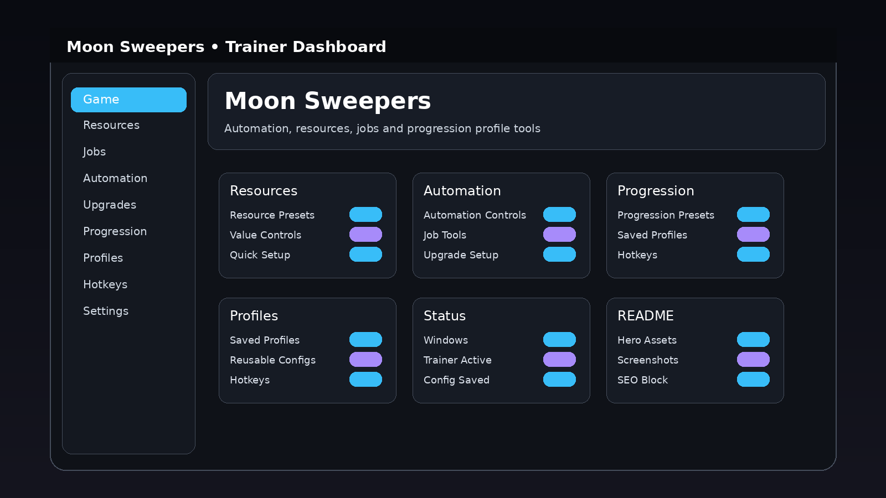

# Moon Sweepers Trainer — Game Enhancer for Windows 10/11

   

---

Moon Sweepers Trainer gives Windows players a sharp, focused dashboard for dialing in the exact configuration they want. Reusable profiles let you save a setup once and load it again without rebuilding it from scratch, while configurable hotkeys keep every option within reach during play. Game-specific dashboard visuals round out the package so the interface reads clean and stays out of the way. It's built for players who want quick presets, saved profiles and direct control in one desktop tool.

## Features

**Resource Presets** — pre-built resource configurations that load instantly, so you can stop digging through menus and get back to the game.

**Value Controls** — fine-grained sliders and inputs for every tracked value, giving you precise control without guesswork.

**Automation Controls** — toggle-driven automation modules designed around Moon Sweepers' core loops, built to run clean and stay out of your way.

**Job Tools** — dedicated controls for job selection and task handling, organized for fast access during active sessions.

**Upgrade Setup** — manage upgrade paths and progression spending from one panel instead of bouncing between screens.

**Progression Presets** — save and recall progression-oriented configurations, perfect for switching strategies between runs.

**Saved Profiles** — reusable profiles let you store complete setups and reload them in seconds. No reconfiguring from scratch every session.

**Configurable Hotkeys** — bind any feature to your own keys. Set it once, then trigger everything mid-game without touching the dashboard.

**Game-Specific Dashboard** — a desktop interface built around Moon Sweepers' actual systems, with visuals that match the game instead of a generic trainer shell.

**Windows Native** — built for Windows PC as a standalone desktop utility. No dependencies, no clutter.

**Platform:** Windows PC only · **Interface:** Desktop dashboard · **Profiles:** Fully supported · **Hotkeys:** Fully configurable · **Presets:** Fully supported

## How It Works

Moon Sweepers Trainer runs as a standalone Windows desktop dashboard layered over your game session. Launch it, pick or build a profile, and the trainer keeps your chosen option groups — resources, automation, progression — staged and ready while you play.

Profiles are the core of the workflow. Every toggle, slider and preset you configure can be saved as a named profile, so switching between a progression run and a utility session is a single click instead of a rebuild. Profiles persist between launches, which means your setup survives reboots and game updates.

Hotkeys are fully configurable and bound per profile. Assign the controls you actually use to keys that fit your hands, and the trainer routes input to the dashboard without forcing you out of the game window. Conflicts are flagged as you assign them, so you won't discover a collision mid-session.

The dashboard itself is built around the game's own structure — option groups mirror how Moon Sweepers organizes resources, jobs and upgrades, so the controls you want are where you'd expect to find them. Visual assets are game-specific rather than generic, keeping the interface readable at a glance during play.

Under the hood, the trainer reads and writes your chosen values through its own profile layer, then applies them when a session is active. Nothing runs in the background when the dashboard is closed, and no profiles are shared or uploaded — your configurations stay local to your machine.

Bottom line: launch, load a profile, play. Everything else is configuration you only do once.

## Configuration

Profiles are the backbone of this trainer, and everything else plugs into them. Set up a configuration once, save it, and reload it whenever you want the exact same setup without touching a single slider.

**Saved Profiles**
- Every profile stores its own option state, so swapping between resource presets, job tools, and upgrade setups takes one click.
- Keep separate profiles for different playstyles — a progression push, a resource-heavy run, a casual session — and switch on the fly.
- Load, rename, duplicate, or delete profiles straight from the dashboard. No config files to hand-edit.

**Hotkeys**
- Rebind every action to the key you actually use. Bindings are stored per profile, so two profiles can share a game but never fight over the same keys.
- Hotkey capture is built into the UI — press the combination, confirm, done. Conflicts get flagged before they bite you.
- Global bindings stay live while the game is focused, so you're not alt-tabbing mid-session.

**Presets and Value Controls**
- Presets ship ready to go; drop one into a profile and adjust from there.
- Fine-tune values within each preset and save the result back to your profile.
- Reset any option group to its defaults without wiping the rest of the profile.

**Dashboard Settings**
- Toggle dashboard visuals and panel behavior to keep the interface out of your way.
- Profiles and hotkey maps persist between launches — open the trainer, pick your profile, play.

## Supported Games

**Moon Sweepers** is the show — the trainer is built around it, not bolted onto a generic shell. Every dashboard visual, option group, and profile slot maps to the game's actual systems, so you're not hunting through a menu that was designed for something else.

What ships in the trainer:

- **Resources** — value controls and presets laid out for quick access mid-run.
- **Automation** — job tools and upgrade setup grouped where you expect them.
- **Progression** — preset bundles and saved profiles you can swap without reconfiguring.
- **Control layer** — configurable hotkeys so the stuff you touch most is never more than a keypress away.

**Platform:** Windows PC only. Desktop dashboard, reusable profiles, and presets are all in scope — if you're on anything other than Windows, this one isn't for you.

Builds target **Moon Sweepers** specifically. Profiles are reusable, so once you've dialed in a setup you like, it's yours to load again — no rebuild from scratch every session.

## FAQ

**Is this safe to run on my PC?**

It's a standalone Windows desktop utility. It doesn't touch your game files or install anything system-wide — you extract it, run it, and delete the folder when you're done. Straightforward.

**Which Windows versions does it support?**

Windows PC is the target platform. Modern 64-bit Windows builds are what it's built and tested against. If you're on something ancient, don't expect miracles.

**Do I need to configure anything before first launch?**

No. Launch it and you get the default profile ready to go. Configure options only when you want to — nothing forces a setup wizard on you.

**How do profiles actually work?**

Pick your options, save them as a profile, load that profile later. Default, Gameplay, Progression, Utility, and Custom are the built-in slots. Custom is yours to shape however you want.

**Can I rebind the hotkeys?**

Yes. Hotkeys are configurable per profile, so different setups can have different bindings. No conflicts forced on you.

**Does it work with multiple game sessions?**

Profiles are reusable across sessions. Same configuration, same hotkeys, every time you load it. No re-doing your setup each launch.

**What happens if I close the trainer mid-session?**

Nothing breaks. The trainer is a separate desktop app — closing it doesn't affect your game. Reload your saved profile when you reopen it.

**Will my saved profiles survive updates?**

Profiles are stored locally, so they persist across launches. Keep the trainer folder intact and your saved configurations stay put.

**Is there a Linux or Mac version?**

No. Windows PC only. Don't ask twice.

**The dashboard looks different from a generic trainer — why?**

It's built with game-specific visuals for Moon Sweepers, not a reskinned template. The dashboard, menu, and detail panels are tailored to the game's option groups.

**Where do I grab the current build?**

Use the download buttons in this README. That's the only place to get it — no third-party mirrors, no sketchy repacks.

## Disclaimer

Moon Sweepers Trainer is a third-party desktop utility built for Moon Sweepers on Windows. It is not affiliated with, endorsed by, or sponsored by the game's developer or publisher. All game names, assets, and trademarks belong to their respective owners.

Use it at your own risk. You are responsible for how you run this tool and for any effect it has on your game account, saves, or system. Back up your profiles and save data before you start tweaking things — that's just good practice.

The trainer ships as-is, with no guarantees about compatibility with future game patches. If the game updates and something breaks, that's expected. Nothing here grants you immunity from a ban, a wipe, or a support ticket that goes sideways.

Only grab builds from the official project page. Anything else floating around isn't ours, and we can't vouch for what's inside it. Keep your antivirus on, read what you're running, and don't hand your credentials to strangers.

Bottom line: it's a tool. You drive it. Play smart.

